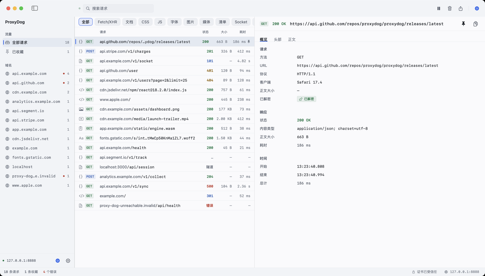
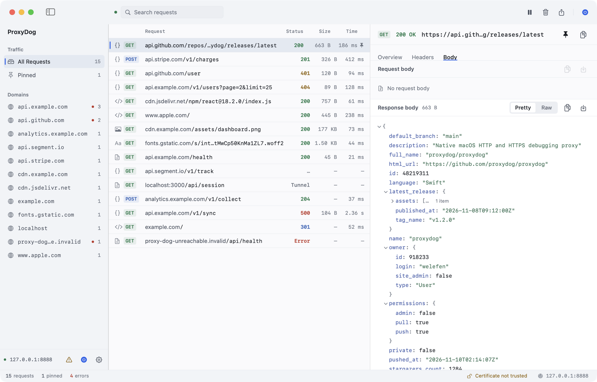
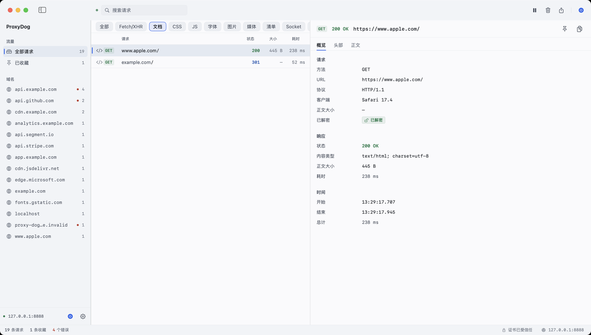
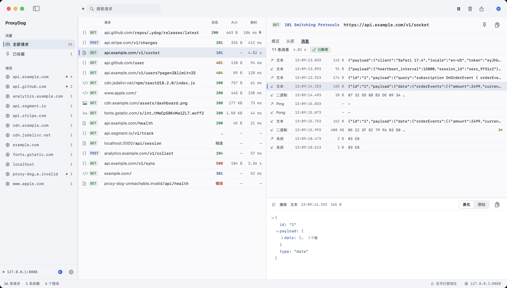
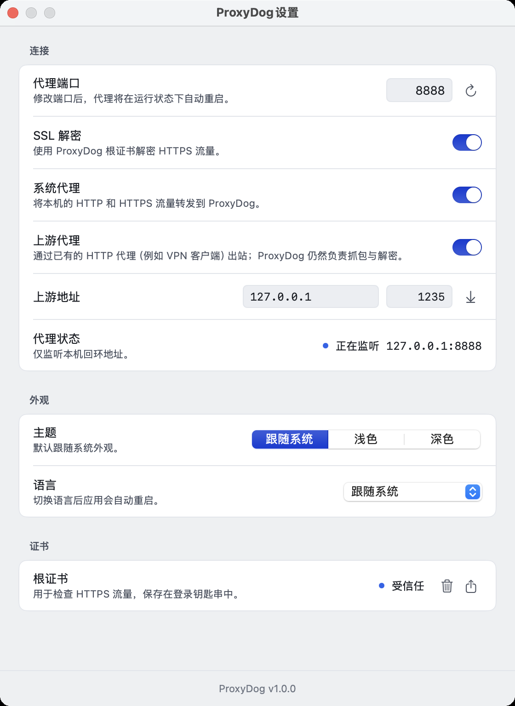
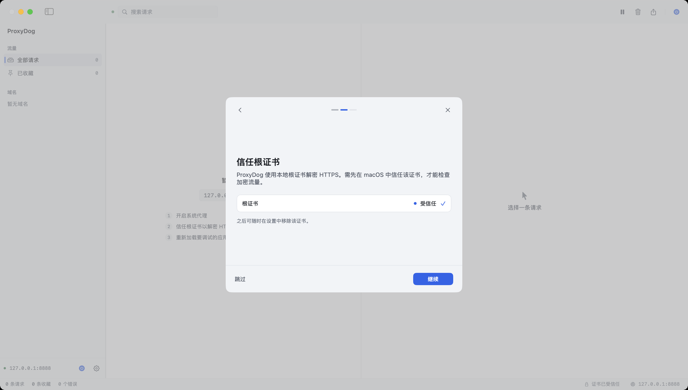
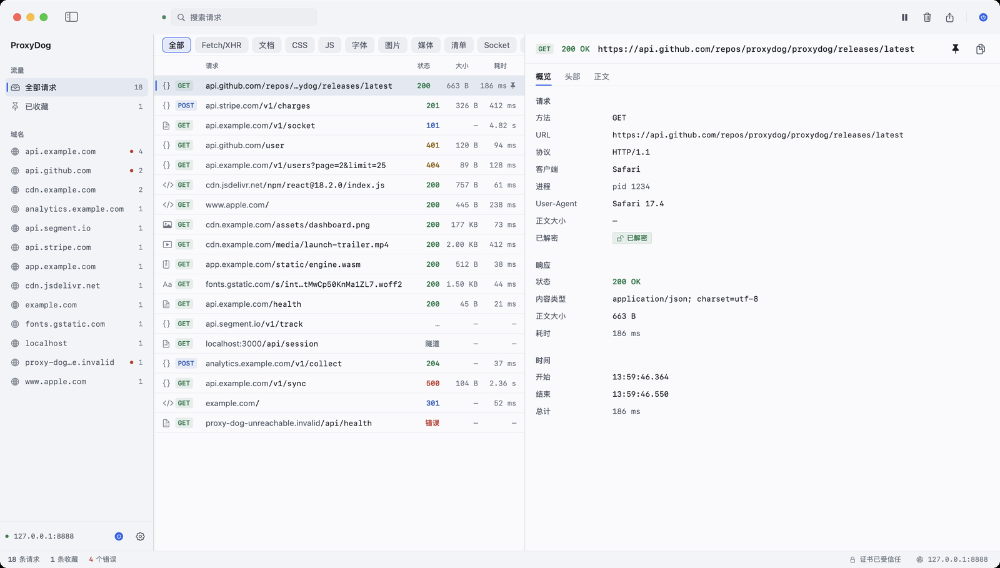

# ProxyDog

原生 macOS HTTP/HTTPS 抓包调试工具，界面与工作流参考 Proxyman。使用 Swift + SwiftUI + SwiftNIO 编写，无需 Xcode 工程即可构建。

## 功能

- **HTTP / HTTPS 抓包**：本地 HTTP 代理监听 `127.0.0.1:8888`，通过本地根证书对 HTTPS 做 TLS 解密（MITM），明文与加密流量统一展示。
- **实时请求列表**：方法、状态码、大小、耗时、协议类型图标；域名分组、失败标记、收藏（Pinned）。
- **请求详情**：Overview（URL、客户端、耗时、大小、解密状态）、Headers（请求/响应表头，点击复制）、Body（JSON 树、文本、图片预览、二进制 Hex、Pretty/Raw 切换）、Messages（WebSocket 消息）。
- **WebSocket 调试**：抓取 101 升级握手，按帧解析双向消息（文本/二进制/ping/pong/关闭、分片重组），wss 自动解密；详情页「消息」标签实时追加，可查看每条消息内容。
- **请求归属**：通过 libproc 反查发起连接的本地进程，详情页显示是哪个 App（含 PID，可看可执行路径），并保留原始 User-Agent。
- **检索与筛选**：全文搜索、按域名过滤、Chrome DevTools 风格的类型筛选（Fetch/XHR、Doc、CSS、JS、Font、Img、Media、Manifest、Socket、Wasm、Other）、暂停/恢复抓包、清空、单条删除、收藏。
- **导出**：HAR 1.2 文件导出、复制为 cURL。
- **系统代理**：一键设置/关闭 macOS 系统 HTTP/HTTPS 代理（需要管理员授权）。
- **上游代理（代理链）**：出站流量可以再交给已有的 HTTP CONNECT 或 SOCKS5 代理（例如本机正在运行的 VPN 客户端），抓包解密与 VPN 出网同时生效。
- **SOCKS5 代理端口**：额外监听 `127.0.0.1:8889`（可修改），只支持 SOCKS5 的 App（如 Telegram）也能指向 ProxyDog 被抓包、解密。
- **外观与语言**：浅色为默认设计，完整支持深色模式，默认跟随系统；界面内置简体中文与 English，默认跟随系统语言，可在设置中切换（切换后自动重启生效）。
- **数据埋点**：使用 Aptabase，App Key 由开发者在构建时配置一次（`Support/AppConfig.plist`，不随仓库提交），最终用户无需填写；不采集任何请求内容。

## 截图

主界面：左侧域名导航，中间是搜索框、Chrome 风格的类型筛选条和请求列表，右侧详情。



Body 详情：JSON 树与 Pretty/Raw 切换。



类型筛选：Chrome DevTools 风格，按 Fetch/XHR、文档、CSS、JS、字体、图片、媒体、清单、Socket、Wasm、其他筛选。



WebSocket 消息：101 握手、双向消息列表、载荷（文本/JSON/二进制 Hex）查看。



设置页：连接（端口、SSL 解密、系统代理、上游代理/代理链、SOCKS5 端口）、外观（主题与语言）、证书，底部显示版本号。



首次启动：一页完成根证书信任、代理地址确认与系统代理设置。



## 语言

界面支持简体中文与 English 两套文案，默认跟随系统语言（本机为中文时即中文界面）。设置 → 外观 → 语言 可在「跟随系统 / 简体中文 / English」之间切换，切换后应用会自动重启。所有界面文案都放在 `Resources/Localization/` 下的 `.strings` 片段里，新增文案时同步补全两种语言，并用 `python3 scripts/check_localization.py` 校验。

## 环境要求

- macOS 14 或更高版本
- Xcode Command Line Tools（`xcode-select --install`），Swift 5.9+；不需要安装完整 Xcode

## 构建与运行

```bash
# 构建可双击运行的 ProxyDog.app（输出到 build/ProxyDog.app）
./scripts/build_app.sh

# 构建并启动
./scripts/run_app.sh
```

首次构建会通过 SwiftPM 拉取 swift-nio / swift-nio-ssl 并编译 BoringSSL，耗时数分钟。

埋点 Key 属于构建期配置：把 `Support/AppConfig.plist.example` 复制为 `Support/AppConfig.plist` 并填入 Aptabase App Key（该文件已加入 `.gitignore`），构建时脚本会把它注入 App 包；不填则埋点自动关闭，界面不会向用户询问 Key。

## 使用

1. 启动后代理自动监听 `127.0.0.1:8888`（可在设置中修改端口）。
2. 首次启动页中安装 ProxyDog 根证书，否则 HTTPS 流量只能看到 CONNECT 隧道。
3. 打开设置页的「System proxy」，或手动把客户端代理指向 `127.0.0.1:8888`。
4. 用 curl 验证：

```bash
curl -x http://127.0.0.1:8888 http://example.com/
curl -x http://127.0.0.1:8888 https://example.com/    # 未安装根证书时 curl 需要加 -k
```

抓到的请求会实时出现在列表中，点击任意一条查看详情。

## 复用已有的代理 / VPN

系统里已经开着一个代理（VPN 客户端、Clash/Surge 之类）时，不需要关掉它：ProxyDog 支持设置**上游代理**，把出站流量再链给它。

1. 打开 设置 → 连接 → 上游代理。**地址会在打开设置页时自动探测并预填**：读取当前系统 HTTP 代理（例如 `127.0.0.1:1235`），无需手工输入；如果系统代理之后变了，点右侧的 ↓ 图标可重新探测。按需把协议切换成 HTTP 或 SOCKS5（很多 VPN 客户端同时提供两个端口，例如 HTTP `1235` / SOCKS5 `1234`），再打开开关即可。
2. 然后把系统代理（或你要调试的 App）指向 ProxyDog：`127.0.0.1:8888`。
3. 此后请求先经 ProxyDog 解密抓包，再由 VPN 代理出网；抓包列表里只会出现客户端真实访问的域名，上游代理本身不会出现。

也可以用命令行验证（`--upstream` 支持 `socks5://` 前缀）：

```bash
./.build/debug/ProxyDog --headless --port 8889 --upstream socks5://127.0.0.1:1234 --out /tmp/chained.jsonl
curl -x http://127.0.0.1:8889 https://example.com/
```

限制：上游代理需支持 HTTP CONNECT 或 SOCKS5 匿名连接（不支持需要认证的代理，也不支持 SOCKS5 的 UDP ASSOCIATE）；上游地址不能指向 ProxyDog 自身，否则设置页会报错。

## 让只支持 SOCKS5 的 App 接入

部分 App（例如 Telegram）只提供 SOCKS5 代理设置。ProxyDog 可以额外开一个 SOCKS5 监听端口：

1. 设置 → 连接 → SOCKS5 代理，打开开关（默认端口 `8889`，可修改）。
2. 在那个 App 里填 SOCKS5 代理：`127.0.0.1:8889`（Hostname 解析交给代理）。
3. 请求出现在 ProxyDog 列表里：HTTPS 自动解密（`已解密`），明文 HTTP 也能抓；连到非 HTTP 协议的 TCP 流量（例如 SSH）只做转发、不显示为请求。

```bash
./.build/debug/ProxyDog --headless --port 8888 --socks-port 8889 --out /tmp/caps.jsonl
curl --socks5-hostname 127.0.0.1:8889 https://example.com/
```

## 请求来自哪个 App

代理只看到 TCP 连接，ProxyDog 会反查是哪个本地进程打开了这条连接：

- 详情页「概览」里显示 **客户端**（App 名，如 Safari）、**进程**（PID，悬停可看可执行路径）和 **User-Agent**。
- 通过 `libproc` 枚举本机进程的 TCP socket 与客户端源端口匹配，不需要额外权限，也不需要安装驱动；从 helper 进程（如 WebKit 网络进程）会向上找到所属的 `.app` 包名。
- 归属是异步解析的：请求先出现，App 信息随后补上；浏览器等长连接会复用连接，开销很小。



限制：只能看到**当前用户**的进程（root 守护进程可能显示为空）；通过其他机器/设备转到本机代理的流量没有本地进程可言；静态链接或无 socket 归属的极端情况可能无法识别。

## WebSocket 调试

`ws://` 与 `wss://` 都支持：

1. 像普通请求一样出现在列表里（状态 101），`wss://` 会先做 TLS 解密再升级。
2. 选中该请求 → 详情页「消息 / Messages」标签：按时间顺序列出双向消息，箭头表示方向（↑ 客户端→服务端，↓ 服务端→客户端），显示类型、时间、大小和内容预览；点击消息在下方查看完整内容（文本支持 Pretty/Raw 与 JSON 美化，二进制以 Hex 展示）。
3. 消息在连接期间实时追加；超长消息按 512KB 截断（会标注「已截断」，字节数仍为真实大小），每个连接最多保留 2000 条 / 4MB。

```bash
./.build/debug/ProxyDog --headless --port 8888 --out /tmp/caps.jsonl
./scripts/ws_test.py server 18996        # 本地 WS echo 服务器
./scripts/ws_test.py plain 8888 127.0.0.1 18996   # 通过 ProxyDog 跑一次 ws
```

限制：不解析 `permessage-deflate` 压缩帧（按二进制原样保存）、不支持 WebSocket over HTTP/2；ping/pong 与 close 控制帧只记录内容，不影响转发。

## 根证书

- 位置：`~/Library/Application Support/ProxyDog/Certificates/ca.crt`
- 安装 / 移除：设置页 → Certificate；安装会把证书加入登录钥匙串并写入用户信任域，系统会弹出标准授权弹窗。如果安装后仍显示「未受信任」，可在「钥匙串访问」中把 `ProxyDog Root CA` 手动设为「始终信任」，然后回到应用点一次刷新。
- 证书仅用于本机抓包调试，卸载应用后建议在「钥匙串访问」中删除该根证书。

## 数据埋点

埋点使用 Aptabase。App Key 只在**开发构建时**配置一次：`Support/AppConfig.plist` 中的 `AptabaseAppKey` 由 `scripts/build_app.sh` 注入到 App 包的 `Info.plist`，最终用户的设置页和首次启动页里都没有 Key 输入项。该文件不提交到仓库，留空则埋点完全关闭。

事件只包含启动、开始/停止代理、导出等行为与操作系统版本等基础信息，不含任何请求内容，因此不提供隐私协议页面。调试时也可以用环境变量 `PROXYDOG_APTABASE_KEY` 或启动参数 `--aptabase-key` 临时覆盖。

## 项目结构

```
Sources/ProxyDog/
├── ProxyDogApp.swift        # SwiftUI 入口、窗口、菜单
├── AppState.swift           # 应用状态与动作（UI 唯一数据入口）
├── main.swift               # 正常启动 / --headless 分流
├── Models/                  # 抓包数据模型、存储、设置、构建期配置、HAR、埋点
├── Core/                    # NIO 代理引擎、证书颁发、系统代理
├── UI/                      # 主窗口、设置页、首次启动页、设计系统
└── Dev/                     # headless 运行与自检
scripts/                     # 构建、运行、测试、截图、图标、演示流量
Support/                     # Info.plist、应用图标、AppConfig.plist(.example)
```

## 开发与测试

```bash
# 快速编译检查
./scripts/build.sh

# 端到端代理测试：明文 HTTP、HTTPS 解密、POST、失败请求、抓包断言、端口复用
./scripts/test_proxy.sh

# 上游代理（代理链）测试：内置本地双协议代理（HTTP CONNECT + SOCKS5）
./scripts/test_upstream.sh
UPSTREAM_REAL=127.0.0.1:1235 ./scripts/test_upstream.sh   # 再用真实 VPN 的 HTTP 代理跑一遍

# 请求归属测试：curl / Python 客户端 / MITM / SOCKS5 连接都能识别出 App
./scripts/test_attribution.sh

# WebSocket 测试：ws/wss 握手、MITM 解密、双向消息解析、分片重组、1MB 截断
./scripts/test_websocket.sh

# SOCKS5 监听器测试：HTTPS 解密、HTTP 捕获、SOCKS5 上游链路、失败路径
./scripts/test_socks.sh
UPSTREAM_SOCKS_REAL=socks5://127.0.0.1:1234 ./scripts/test_socks.sh   # 再用真实 VPN 的 SOCKS5 端口跑一遍

# 无界面自检：证书签发、HAR 导出、cURL 导出、进程内重启、端口占用、设置持久化
./.build/debug/ProxyDog --headless --selftest

# 无界面启动代理（输出 JSON Lines 抓包事件）
./.build/debug/ProxyDog --headless --port 8899 --out /tmp/captures.jsonl

# 校验中英文案完整性
python3 scripts/check_localization.py

# 生成演示流量 / 重置应用状态 / 截取窗口
./scripts/demo_traffic.sh
./scripts/reset_app.sh
./scripts/screenshot.sh /tmp/proxydog.png
```

开发调试时可以载入一组示例流量，便于在没有真实请求时检查界面（`--sample-tab body` 会打开 Body 页，`--sample-request N` 选中第 N 条）：

```bash
defaults write com.proxydog.app app.onboardingCompleted -bool true
./build/ProxyDog.app/Contents/MacOS/ProxyDog --sample-traffic
./build/ProxyDog.app/Contents/MacOS/ProxyDog --sample-traffic --sample-tab body
```

## 已知限制

- 仅支持 HTTP/1.1：TLS 握手时 ALPN 只协商 `http/1.1`，不支持 HTTP/2 帧解析。
- 上游 TLS 不校验证书，便于抓取自签名证书的开发服务器。
- WebSocket 不解析 `permessage-deflate` 压缩帧，也不支持 WebSocket over HTTP/2。
- 单个请求/响应体最多保存 2 MB（超出部分仍然透传，仅不入库）。
- 关闭系统代理时直接关闭代理开关，不会恢复开启前的原有代理配置。

## 版本

v1.0.0
