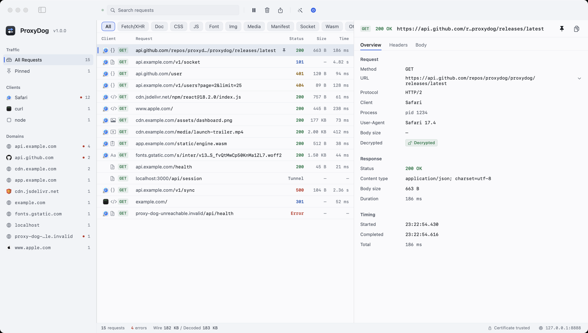
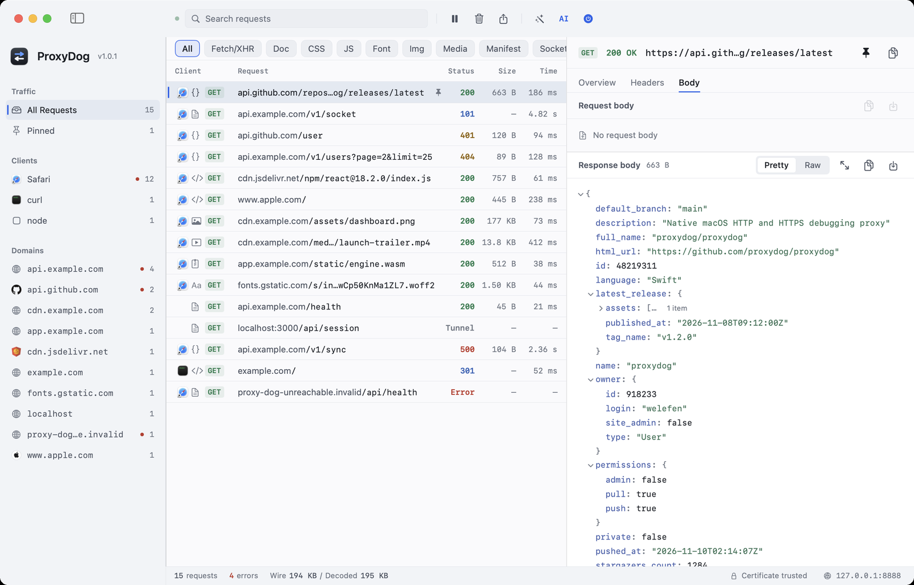
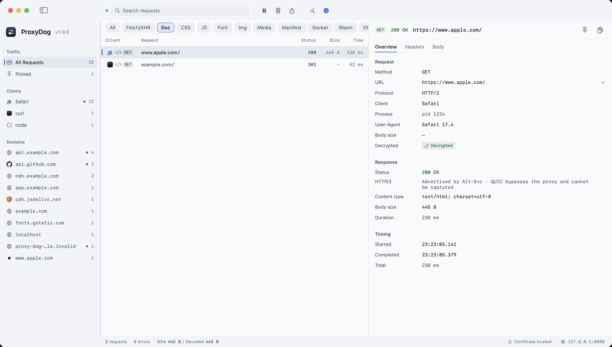
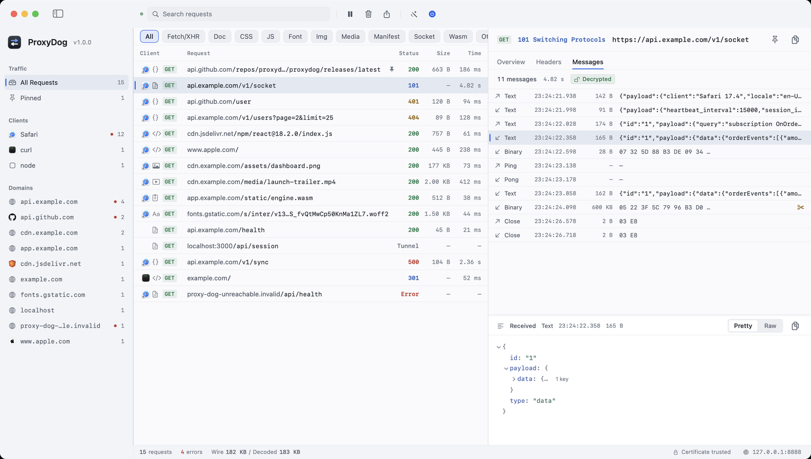
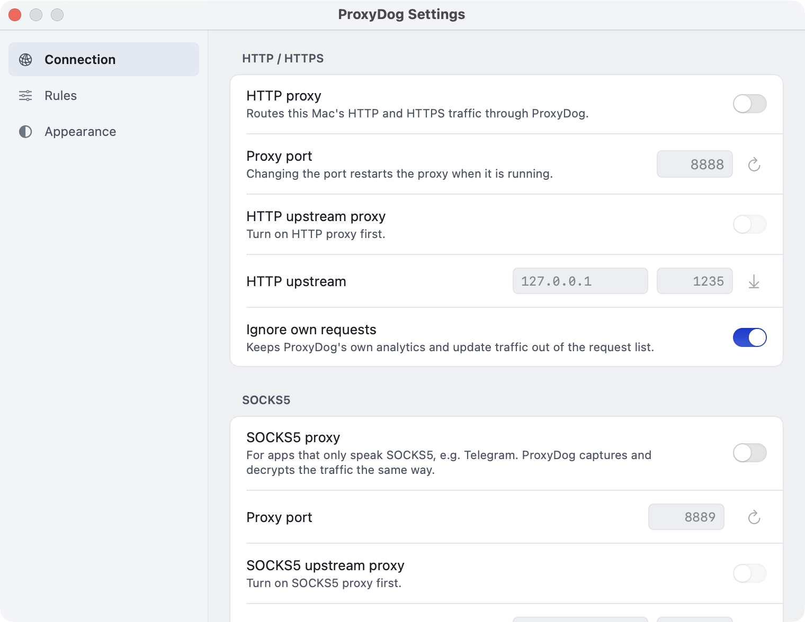
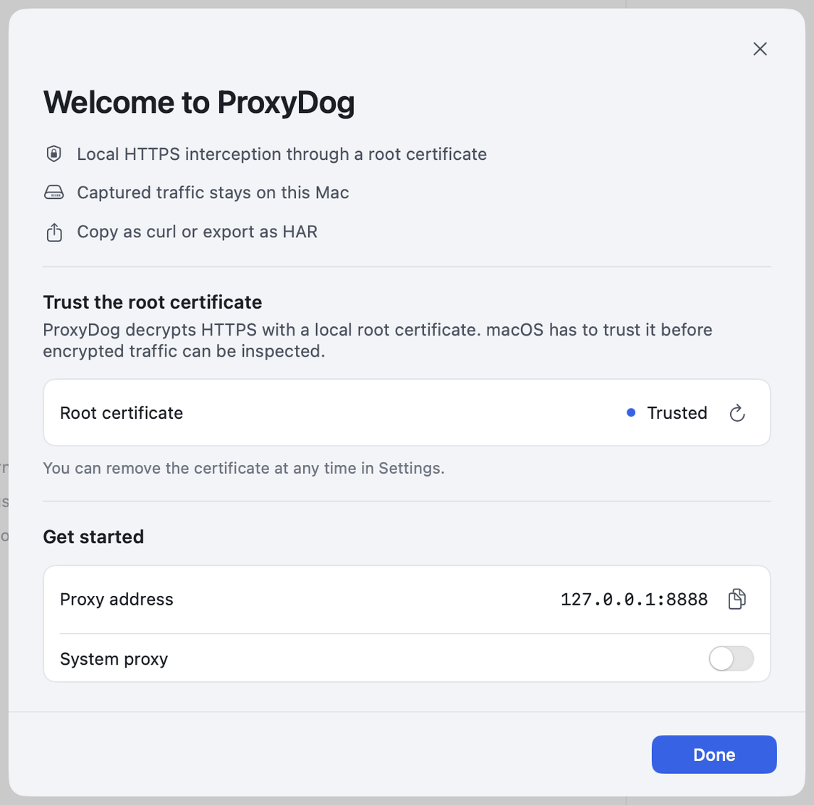
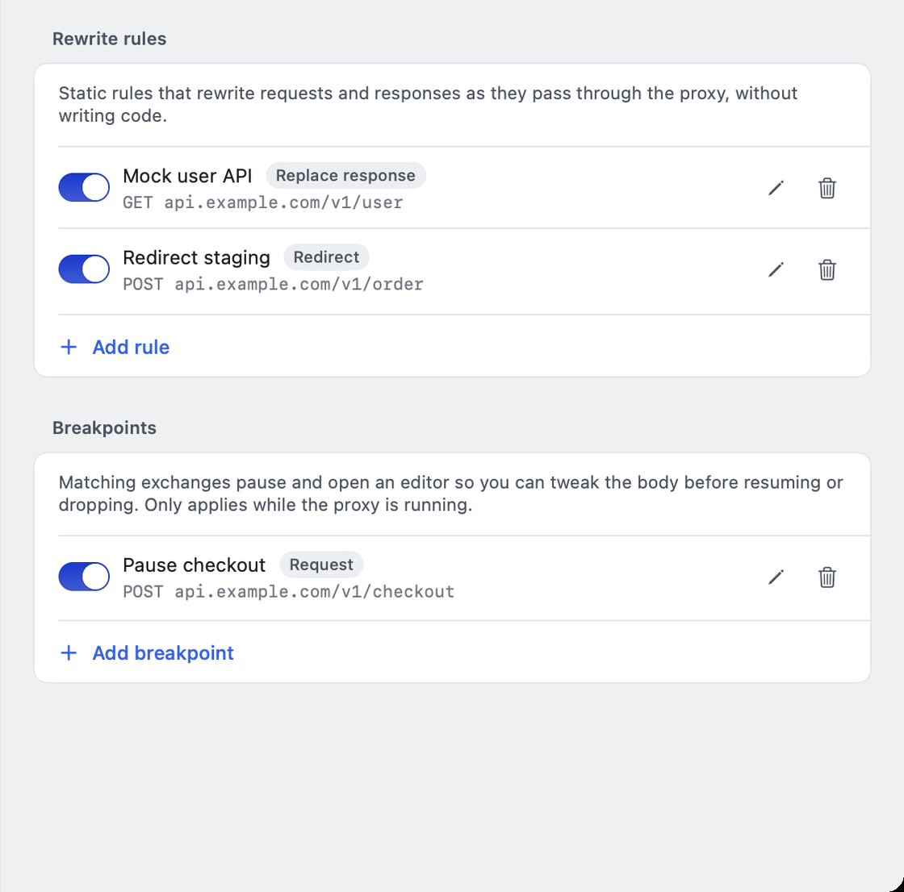
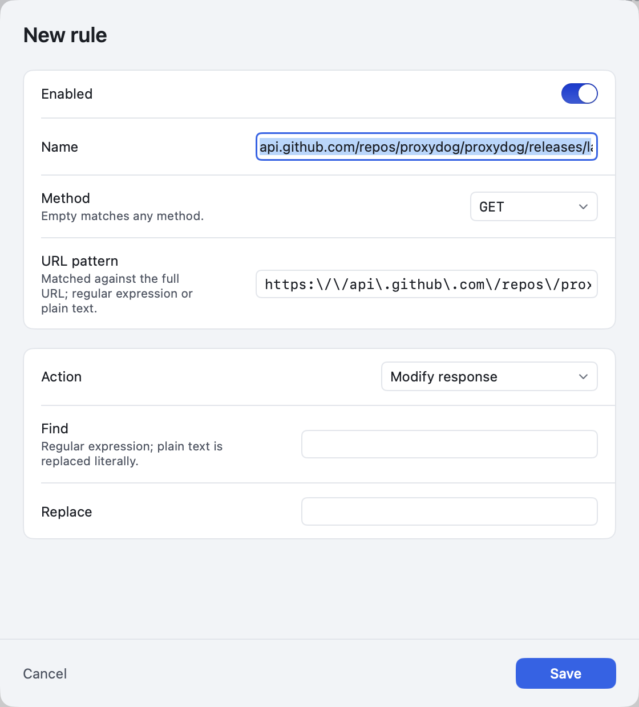
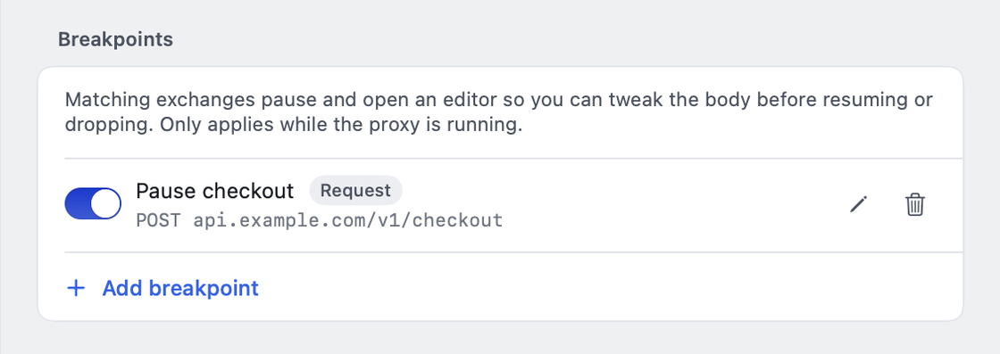
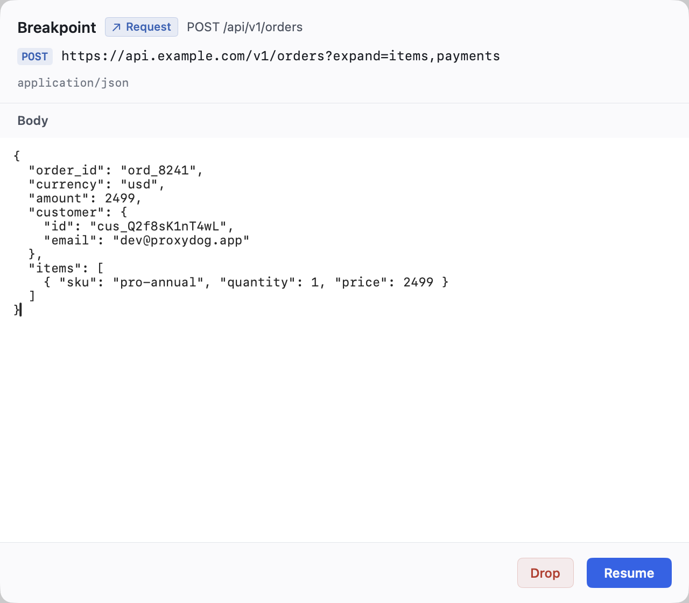

# ProxyDog

**English** | [简体中文](README.zh-CN.md)

A native, lightweight HTTP/HTTPS debugging proxy for macOS with a Proxyman/Charles-style workflow that works out of the box: see which app each request came from, decrypt HTTPS with one click and read the decoded body, inspect WebSocket messages, rewrite traffic, pause requests with breakpoints, and route through SOCKS5 or an existing VPN proxy — all in one window.

[](https://github.com/welefen/ProxyDog/raw/master/updates/ProxyDog-1.0.0.zip)

## Features

- **HTTP / HTTPS capture**: a local proxy listens on `127.0.0.1:8888` and decrypts TLS (MITM) using a locally generated root certificate, showing plain and encrypted traffic side by side. HTTP/2 is negotiated via ALPN and labelled (`HTTP/2`) in the inspector.
- **HTTP/2 support**: browsers talk HTTP/2 to ProxyDog (multiplexed streams, one record per stream) while upstream connections use HTTP/1.1 (the same downgrade strategy Charles uses), so requests, responses and compressed bodies on h2 sites are captured in full.
- **Live request list**: method, status, size, duration and protocol icons; the sidebar groups traffic by **Client** and **Domain** (clients show their app icon, domains show site favicons with parent-domain and globe fallbacks; favicon fetching reuses the configured upstream or system proxy so VPN-only sites still get icons). Failed requests and pinned requests are marked.
- **Request inspector**: Overview (URL, client, timing, size, decryption state), Headers (request/response with copy), Body (JSON tree, text, image preview, binary hex, Pretty/Raw), Messages (WebSocket frames).
- **WebSocket debugging**: captures the 101 upgrade and parses frames in both directions (text/binary/ping/pong/close, fragmented messages reassembled); `wss://` is decrypted automatically. The Messages tab appends frames live with previews and full payloads.
- **Request attribution**: figures out which local process opened each connection via `libproc` and shows the app name, PID/path and the original User-Agent in the inspector.
- **Search and filters**: full-text search, per-domain filtering, Chrome DevTools-style type chips (Fetch/XHR, Doc, CSS, JS, Font, Img, Media, Manifest, Socket, Wasm, Other), pause/resume, clear, delete single rows and pinning.
- **Rewrite rules**: no-code static rules evaluated as traffic flows: redirect, replace request, replace response, modify request, modify response (URL regex/substring plus optional HTTP method). Applies to both HTTP/1.1 and HTTP/2 traffic.
- **Breakpoints**: pause matching requests before they are forwarded or responses before they are written, edit the body in a modal editor, then resume or drop. One-shot, so other traffic keeps flowing.
- **Export**: HAR 1.2 export and “copy as cURL”.
- **HTTP proxy**: one switch to set/clear the macOS system HTTP/HTTPS proxy (requires admin authorization).
- **Upstream proxies (proxy chaining)**: chain outbound traffic through an existing HTTP or SOCKS5 proxy such as a local VPN client; decryption and VPN egress work at the same time. HTTP and SOCKS5 upstreams are stored and switched independently, one per entry point.
- **SOCKS5 listener**: an extra listener on `127.0.0.1:8889` (configurable) lets SOCKS5-only apps such as Telegram be captured and decrypted.
- **Appearance and language**: light-first design with a complete dark mode following the system by default; built-in 简体中文 and English (follows the system language, switchable in Settings with an automatic restart).
- **Auto-update**: checks the manifest (`updates/latest.json`) on GitHub in the background after launch, downloads the ZIP, verifies its SHA-256 plus bundle identifier/version, then installs in place with one “Install and restart” click. “Check for Updates…” in the app menu triggers a manual check; development builds under `build/` opt out automatically.
- **Analytics**: Aptabase, with the app key injected at build time (`Support/AppConfig.plist`, gitignored), so end users never see a key field. No request content is collected.

## Screenshots

Main window: domains on the left, search + Chrome-style type chips + request list in the middle (each row starts with the app icon that made the request), inspector on the right.



Body inspector: JSON tree with Pretty/Raw toggle.



Type filter: Chrome DevTools-style chips for Fetch/XHR, Doc, CSS, JS, Font, Img, Media, Manifest, Socket, Wasm and Other.



WebSocket messages: the 101 handshake, both directions and payload previews (text/JSON/binary hex).



Settings: a sidebar with Connection (HTTP proxy, port, upstream proxies, SOCKS5, SSL & certificate), Rules and Appearance.



First launch: install the root certificate, confirm the proxy address and optionally set the system proxy on a single page.



## Language

The UI ships with English and Simplified Chinese, following the system language by default. Switch between “Follow system / 简体中文 / English” in Settings → Appearance → Language; the app restarts to apply it. All strings live in `.strings` fragments under `Resources/Localization/`; add both languages and verify with `python3 scripts/check_localization.py`.

## Requirements

- macOS 14 or newer
- Xcode Command Line Tools (`xcode-select --install`), Swift 5.9+; a full Xcode installation is not required

## Build and run

```bash
# Build a double-clickable ProxyDog.app (output: build/ProxyDog.app)
./scripts/build_app.sh

# Build and launch
./scripts/run_app.sh
```

The first build fetches swift-nio / swift-nio-ssl via SwiftPM and compiles BoringSSL, which takes a few minutes. The analytics key is build-time configuration: copy `Support/AppConfig.plist.example` to `Support/AppConfig.plist` and fill in the Aptabase app key (gitignored); without it analytics is disabled and the UI never asks for a key.

## Usage

1. The proxy starts automatically and listens on `127.0.0.1:8888` (changeable in Settings).
2. Install the ProxyDog root certificate from the first-launch page (or Settings → Connection → SSL & certificate); otherwise HTTPS traffic only shows up as CONNECT tunnels.
3. Turn on “HTTP proxy” in Settings, or point a client at `127.0.0.1:8888` manually.
4. Verify with curl:

```bash
curl -x http://127.0.0.1:8888 http://example.com/
curl -x http://127.0.0.1:8888 https://example.com/    # add -k when the root certificate is not installed
```

Captured requests appear in the list immediately; select one to open the inspector.

## Reusing an existing proxy / VPN

If a proxy is already running (a VPN client, Clash/Surge, etc.) you do not have to turn it off: configure it as an **upstream proxy** and ProxyDog chains to it.

1. Open Settings → Connection → HTTP upstream proxy / SOCKS5 upstream proxy. Addresses are detected and pre-filled when the settings window opens (it reads the system HTTP/SOCKS proxy, e.g. `127.0.0.1:1235`); press the ↓ button to re-detect. HTTP and SOCKS5 upstreams have independent switches and are used per entry point (traffic from the HTTP proxy port uses the HTTP upstream, traffic from the SOCKS5 listener uses the SOCKS5 upstream). An empty or incomplete address simply disables that upstream.
2. Point the system proxy (or the app you are debugging) at ProxyDog: `127.0.0.1:8888`.
3. Requests are decrypted and captured by ProxyDog, then leave through the VPN proxy; the list only contains the domains the client actually visited, never the upstream proxy itself.

You can also verify on the command line (`--upstream` accepts a `socks5://` prefix):

```bash
./.build/debug/ProxyDog --headless --port 8889 --upstream socks5://127.0.0.1:1234 --out /tmp/chained.jsonl
curl -x http://127.0.0.1:8889 https://example.com/
```

Limitations: upstream proxies must support HTTP CONNECT or anonymous SOCKS5 (authenticated proxies and SOCKS5 UDP ASSOCIATE are not supported); an upstream cannot point at ProxyDog itself.

## Connecting SOCKS5-only apps

Some apps (Telegram, for example) only expose a SOCKS5 proxy setting. ProxyDog can open an extra SOCKS5 listener:

1. Settings → Connection → SOCKS5 proxy, turn it on (default port `8889`, changeable).
2. Configure the app with SOCKS5 proxy `127.0.0.1:8889` (leave hostname resolution to the proxy).
3. Requests show up in the list: HTTPS is decrypted automatically (`Decrypted`), plain HTTP is captured as well; non-HTTP TCP traffic (e.g. SSH) is tunnelled but not shown as a request.

```bash
./.build/debug/ProxyDog --headless --port 8888 --socks-port 8889 --out /tmp/caps.jsonl
curl --socks5-hostname 127.0.0.1:8889 https://example.com/
```

## Which app did a request come from?

A proxy only sees TCP connections, so ProxyDog resolves the local process that opened each one:

- The Overview tab shows the **client** (app name, e.g. Safari), the **process** (PID, hover for the executable path) and the **User-Agent**.
- It enumerates local TCP sockets via `libproc` and matches the client source port — no extra permissions or kernel extensions; helper processes (e.g. WebKit networking) are resolved up to their owning `.app`.
- Attribution is asynchronous: the request appears first and the app information is filled in afterwards. Long-lived browser connections are reused, so the overhead is negligible.
- ProxyDog's own traffic (analytics, update checks) is detected and hidden by default; turn it off in Settings → Connection → Ignore own requests.


Limitations: only processes of the **current user** are visible (root daemons may show as empty); traffic forwarded from another machine/device has no local process; statically linked or socket-less edge cases may not be attributable.

## WebSocket debugging

Both `ws://` and `wss://` are supported:

1. They appear like normal requests (status 101); `wss://` is decrypted before the upgrade.
2. Select the request → Messages tab: both directions in chronological order with arrows (↑ client→server, ↓ server→client), type, time, size and a preview; select a message to see the full payload below (text with Pretty/Raw and JSON formatting, binary as hex).
3. Messages append live; oversized messages are truncated at 512 KB (marked “truncated”, byte counts stay real), and each connection keeps at most 2000 messages / 4 MB.

```bash
./.build/debug/ProxyDog --headless --port 8888 --out /tmp/caps.jsonl
./scripts/ws_test.py server 18996                                # local WS echo server
./scripts/ws_test.py plain 8888 127.0.0.1 18996                  # run ws through ProxyDog
```

Limitations: `permessage-deflate` frames are not decompressed (stored as binary), WebSocket over HTTP/2 is not supported, and ping/pong/close frames are recorded but passed through unchanged.

## Rewrite rules

The wand icon in the main toolbar opens Settings → Rules. Static rules rewrite requests and responses as they pass through the proxy, no code required; right-click a request and choose “Rewrite this URL…” to create a rule from its URL. Each rule has an optional HTTP method, a URL matcher (regex, or plain text for substring matching) and one action:

| Action | What it does | Example |
|---|---|---|
| Redirect | Forward the request to another URL | Send an endpoint to a staging environment |
| Replace request | Replace the request body with fixed content | Force fixed test parameters |
| Replace response | Answer locally without hitting upstream | Replace a live API response with local JSON |
| Modify request | Regex find/replace on the request body | Batch-change `code:0` to `code:-1` |
| Modify response | Regex find/replace on the response body | Test the frontend error path for `code:-1` |





Notes:

- Only the **first matching enabled** rule in a phase applies; disabled rules never match.
- Modify response decompresses gzip/deflate first and returns an uncompressed body with a corrected Content-Length; br/zstd, binary or bodies over 16 MB pass through untouched.
- Request body replacements/modifications support up to 32 MB; WebSocket upgrade requests are not rewritten.
- Rewritten exchanges are labelled “Rewrite · action” in the Overview tab, and HAR exports contain the rewritten content.

## Breakpoints

Unlike always-on rewrite rules, breakpoints **pause once, let you edit, and apply to a single exchange** — handy for trying values temporarily. Configure rules in Settings → Rules → Breakpoints by URL (regex/substring plus optional method) and choose the **request** or **response** phase; “Breakpoint this URL…” in the request context menu creates one quickly (request phase by default):



When a rule hits, the main window shows a modal editor with the method, URL, status code and original body. Edit the body and press Resume, or Drop to fail the request. Multiple matches queue up (“N more waiting”):



Notes:

- Request phase: pauses before connecting upstream, edits the request body (Content-Length fixed automatically); dropping returns 403 to the client without contacting upstream.
- Response phase: pauses before writing to the client, edits the response body (gzip/deflate is decompressed, returned uncompressed with a corrected Content-Length); dropping closes the connection.
- Only UTF-8 decodable bodies pause (binary, br/zstd and oversized bodies resume automatically); WebSocket upgrades are not paused.
- After 120 seconds without a decision the exchange resumes automatically so requests never hang.
- Breakpointed exchanges are labelled “Breakpoint · phase” in the Overview tab.

## Root certificate

> HTTPS decryption needs a trusted root certificate: while it is missing or untrusted the “SSL decryption” switch is disabled and the proxy turns decryption off automatically (HTTPS only shows as tunnels). The install entry is the “SSL & certificate” block at the bottom of Settings → Connection.

- Location: `~/Library/Application Support/ProxyDog/Certificates/ca.crt`
- Install / remove: Settings → Connection → SSL & certificate; installing adds the certificate to the login keychain with user-domain trust and triggers the standard authorization prompt. If it still shows “Not trusted”, set “ProxyDog Root CA” to “Always Trust” in Keychain Access and refresh in the app.
- The certificate is only for local debugging; remove the root certificate from Keychain Access after uninstalling the app.

## Auto-update

Auto-update is implemented in-app (the same approach as the sibling TidyMac project, no Sparkle):

1. Three seconds after launch the app fetches the manifest from `https://api.github.com/repos/welefen/ProxyDog/contents/updates/latest.json?ref=master`, falling back to `https://raw.githubusercontent.com/welefen/ProxyDog/master/updates/latest.json`.
2. The manifest contains `version`, `downloadURL`, `sha256` and `releaseNotes`; when the version is newer the ZIP is downloaded and its SHA-256 verified.
3. The archive is extracted; the bundle identifier (`com.proxydog.app`) and version are verified, and the new `ProxyDog.app` is staged. “Install and restart” swaps it in after the app quits and relaunches it.
4. When an update is available the version label in the main-window sidebar is replaced by a circular update button: a pulsing down arrow while downloading, then an up arrow once ready. Hovering expands it into a “Finish update” pill; clicking installs and restarts (same interaction as TidyMac).
5. Automatic checks only run for installed builds (development builds under `build/` opt out). Debug overrides: `PROXYDOG_UPDATE_FEED`, `PROXYDOG_CURRENT_VERSION`, `PROXYDOG_UPDATE_TOKEN`, and `PROXYDOG_UPDATE_DEBUG=1` (log to `/tmp/proxydog-update-debug.log`).

Publishing a release:

```bash
# 1. Bump CFBundleShortVersionString in Support/Info.plist
# 2. Build dist/ artifacts and write updates/ProxyDog-<version>.zip + updates/latest.json
./scripts/publish_update.sh
# 3. Commit and push (or ./scripts/publish_update.sh --push to commit and tag)
git add updates scripts && git commit -m "release: ProxyDog <version>" && git push origin master
```

`package.sh` only packages (DMG + ZIP + SHA256SUMS in `dist/`); `publish_update.sh` additionally refreshes the `updates/` feed. The repository must be public so clients can download releases.

## Analytics

Analytics uses Aptabase. The app key is configured once **at development/build time**: `AptabaseAppKey` in `Support/AppConfig.plist` is injected into the app bundle's `Info.plist` by `scripts/build_app.sh`, so there is no key field in the settings or onboarding UI. The file is not committed; without it analytics is fully disabled.

Events contain only behaviours such as launch, start/stop proxy and export, plus basic OS version information — never request content — which is why there is no privacy page. For debugging, override with `PROXYDOG_APTABASE_KEY` or `--aptabase-key`.

## Project structure

```
Sources/ProxyDog/
├── ProxyDogApp.swift        # SwiftUI entry point, windows, menus
├── AppState.swift           # App state and actions (single data entry for the UI)
├── main.swift               # normal launch / --headless split
├── Models/                  # Capture models, stores, settings, build-time config, HAR, analytics
├── Core/                    # NIO proxy engine, certificate authority, system proxy
├── UI/                      # Main window, settings, onboarding, design system
└── Dev/                     # Headless runner and self-tests
scripts/                     # Build, run, test, screenshot, icon and demo-traffic scripts
Support/                     # Info.plist, app icon, AppConfig.plist(.example)
```

## Development and testing

```bash
# Fast compile check
./scripts/build.sh

# End-to-end proxy tests: plain HTTP, HTTPS decryption, POST, failures, capture assertions, port reuse
./scripts/test_proxy.sh

# Upstream proxy (chaining) tests: bundled dual-protocol proxy (HTTP CONNECT + SOCKS5)
./scripts/test_upstream.sh
UPSTREAM_REAL=127.0.0.1:1235 ./scripts/test_upstream.sh   # also run against a real VPN HTTP proxy

# HTTP/2 tests: ALPN h2, h2 capture assertions, HTTP/1.1 fallback
./scripts/test_http2.sh

# Rewrite rule tests: all five actions, disabled rules, capture annotations
./scripts/test_rewrite.sh

# Breakpoint tests: pause on request/response, body edits, drops, disabled rules, capture phases
./scripts/test_breakpoint.sh

# Attribution tests: curl / Python clients / MITM / SOCKS5 connections all resolve an app
./scripts/test_attribution.sh

# WebSocket tests: ws/wss handshake, MITM, both directions, fragmentation, 1MB truncation
./scripts/test_websocket.sh

# SOCKS5 listener tests: HTTPS decryption, HTTP capture, SOCKS5 upstream chaining, failures
./scripts/test_socks.sh
UPSTREAM_SOCKS_REAL=socks5://127.0.0.1:1234 ./scripts/test_socks.sh   # also run against a real VPN SOCKS5 port

# Headless self-test: certificate issuance, HAR/cURL export, in-process restart, port conflicts, settings persistence
./.build/debug/ProxyDog --headless --selftest

# Headless proxy (JSON Lines capture events)
./.build/debug/ProxyDog --headless --port 8899 --out /tmp/captures.jsonl

# Localization completeness
python3 scripts/check_localization.py

# Package / publish an update (writes dist/ and updates/latest.json)
./scripts/package.sh
./scripts/publish_update.sh

# Demo traffic / reset app state / capture a window
./scripts/demo_traffic.sh
./scripts/reset_app.sh
./scripts/screenshot.sh /tmp/proxydog.png
```

For UI work without real traffic, load sample data (`--sample-tab body` opens the Body tab, `--sample-request N` selects the Nth row). For load testing, `--sample-stress N` loads N synthetic requests (temporarily lifts the 2000-record cap and prints load/filter/layout timing and memory usage to stderr):

```bash
defaults write com.proxydog.app app.onboardingCompleted -bool true
./build/ProxyDog.app/Contents/MacOS/ProxyDog --sample-traffic
./build/ProxyDog.app/Contents/MacOS/ProxyDog --sample-traffic --sample-tab body
./build/ProxyDog.app/Contents/MacOS/ProxyDog --sample-traffic --sample-stress 10000
```

## Known limitations

- HTTP/2 is client-side only: ProxyDog negotiates HTTP/2 with browsers and captures per stream, but upstream connections stay HTTP/1.1 (no end-to-end h2→h2), and Server Push, h2 extended CONNECT / WebSocket, trailers and 1xx responses are not shown. MITM on the SOCKS5 listener remains HTTP/1.1.
- HTTP/3 (QUIC) is not captured: QUIC runs over UDP while the macOS HTTP/HTTPS system proxy only forwards TCP, so browsers fall back to h2/h1 when proxied and payloads are still complete; genuinely QUIC-only traffic bypasses ProxyDog. Intercepting QUIC would require system-level UDP interception (Network Extension / System Extension with signing entitlements) plus a full QUIC + HTTP/3 stack, which is outside the scope of a plain app. When a response carries `Alt-Svc: h3` the inspector notes that the site supports HTTP/3 (a hint only; QUIC traffic is still not capturable).
- Upstream TLS certificates are not validated, to make self-signed development servers usable.
- WebSocket does not decompress `permessage-deflate` frames and does not support WebSocket over HTTP/2 (h2 extended CONNECT fails and is explained in the inspector).
- At most 2 MB per request/response body is stored (the rest is still forwarded, just not recorded).
- Turning off the system proxy simply disables it; the previous proxy configuration is not restored.

## Version

v1.0.0
