# ProxyDog

[English](README.md) | **简体中文**

一款原生、轻量的 macOS HTTP/HTTPS 抓包调试工具，体验接近 Proxyman/Charles，但打开即用：自动识别每个请求来自哪个 App，一键解密 HTTPS 并还原压缩正文，WebSocket 消息、重写规则、断点调试、SOCKS5 入口和 VPN 代理链都内置在同一个窗口里，无需驱动、无需完整 Xcode。

[](https://github.com/welefen/ProxyDog/raw/master/updates/ProxyDog-1.0.0.zip)

也可以下载 [DMG 磁盘映像](https://github.com/welefen/ProxyDog/raw/master/updates/ProxyDog-1.0.0.dmg)。

## 功能

- **HTTP / HTTPS 抓包**：本地 HTTP 代理监听 `127.0.0.1:8888`，通过本地根证书对 HTTPS 做 TLS 解密（MITM），明文与加密流量统一展示；HTTP/2 通过 ALPN 协商并在抓包中标记（`协议` 行显示 HTTP/2）。
- **HTTP/2 支持**：浏览器与代理之间用 HTTP/2 通信（单连接多路复用，每个流单独记录），转发到上游时使用 HTTP/1.1（与 Charles 相同的降级策略），因此 h2 站点的请求、响应、压缩正文都能完整抓取；详情页协议行会标注 `HTTP/2`。
- **实时请求列表**：方法、状态码、大小、耗时、协议类型图标；侧边栏按「客户端」和「域名」分组（客户端带 App 图标，域名带站点 favicon（子域名取不到时回退主域名图标，再不行回退地球图标；取图标时会走应用配置的上游代理或系统代理，避免依赖 VPN 的站点取不到图标）），支持失败标记、收藏（Pinned）。
- **请求详情**：Overview（URL、客户端、耗时、大小、解密状态）、Headers（请求/响应表头，点击复制）、Body（JSON 树、文本、图片预览、二进制 Hex、Pretty/Raw 切换）、Messages（WebSocket 消息）。
- **WebSocket 调试**：抓取 101 升级握手，按帧解析双向消息（文本/二进制/ping/pong/关闭、分片重组），wss 自动解密；详情页「消息」标签实时追加，可查看每条消息内容。
- **请求归属**：通过 libproc 反查发起连接的本地进程，详情页显示是哪个 App（含 PID，可看可执行路径），并保留原始 User-Agent。
- **检索与筛选**：全文搜索、按域名过滤、Chrome DevTools 风格的类型筛选（Fetch/XHR、Doc、CSS、JS、Font、Img、Media、Manifest、Socket、Wasm、Other）、暂停/恢复抓包、清空、单条删除、收藏。
- **重写规则（Rewrite）**：不写代码的静态规则，在设置里配置后立即生效；支持重定向、替换请求、替换响应、修改请求、修改响应 5 种动作（URL 正则/子串 + 可选 HTTP 方法匹配），HTTP/1.1 与 HTTP/2 流量都适用。
- **断点（Breakpoint）**：命中 URL 的请求在转发前/响应返回前暂停，弹出编辑器可临时修改请求或响应正文，改完「放行」或「丢弃」；单次生效，不影响其他请求。
- **导出**：HAR 1.2 文件导出、复制为 cURL。
- **HTTP 代理**：一键设置/关闭 macOS 系统 HTTP/HTTPS 代理（需要管理员授权）。
- **上游代理（代理链）**：出站流量可以再交给已有的 HTTP CONNECT 或 SOCKS5 代理（例如本机正在运行的 VPN 客户端），抓包解密与 VPN 出网同时生效。
- **局域网设备接入**：打开「允许局域网设备连接」后，代理监听 `0.0.0.0`，同一局域网的其它设备可把本机当作 HTTP 代理；设置里显示代理地址、二维码与证书下载地址（`http://<局域网 IP>:8888/ca.cer`），请求列表会标注「局域网设备 (IP)」并可按设备筛选。
- **SOCKS5 代理端口**：额外监听 `127.0.0.1:8889`（可修改），只支持 SOCKS5 的 App（如 Telegram）也能指向 ProxyDog 被抓包、解密。
- **外观与语言**：浅色为默认设计，完整支持深色模式，默认跟随系统；界面内置简体中文与 English，默认跟随系统语言，可在设置中切换（切换后自动重启生效）。
- **自动更新**：启动后在后台检查 GitHub 上的更新清单（`updates/latest.json`），下载 ZIP 后做 SHA-256 校验与包名/版本校验，点击「安装并重启」即可原地更新；菜单「ProxyDog → 检查更新…」可手动检查，开发构建（`build/` 下）自动跳过。
- **数据埋点**：使用 Aptabase，App Key 由开发者在构建时配置一次（`Support/AppConfig.plist`，不随仓库提交），最终用户无需填写；不采集任何请求内容。

## 截图

主界面：左侧域名导航，中间是搜索框、Chrome 风格的类型筛选条和请求列表（每行最左显示发起请求的 App 图标），右侧详情。

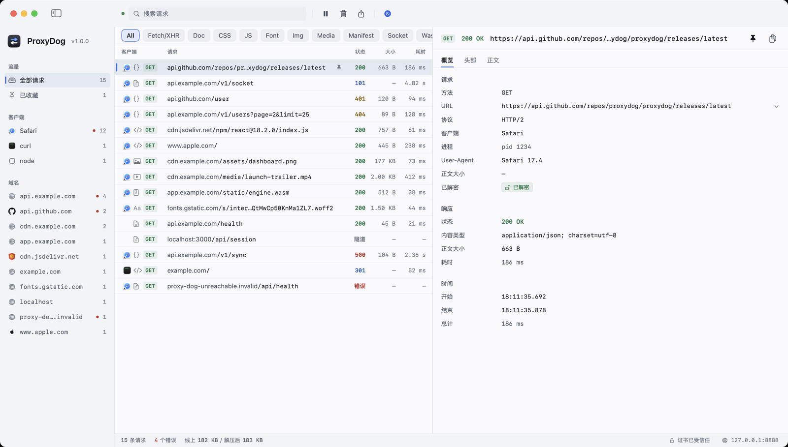

Body 详情：JSON 树与 Pretty/Raw 切换。

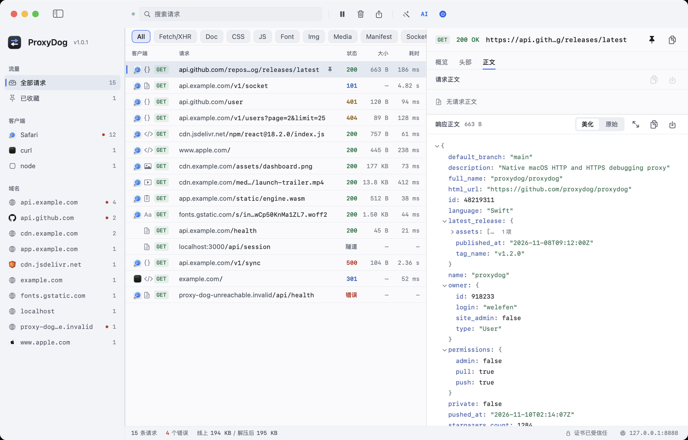

类型筛选：Chrome DevTools 风格，按 Fetch/XHR、文档、CSS、JS、字体、图片、媒体、清单、Socket、Wasm、其他筛选。

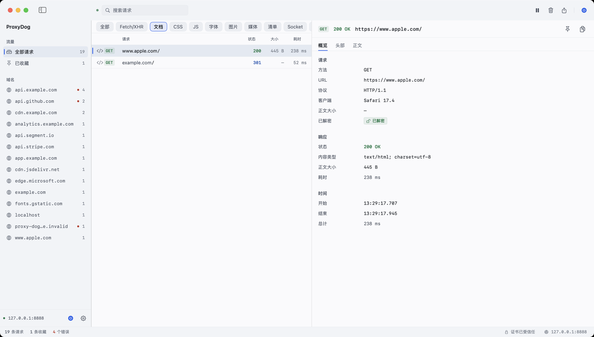

WebSocket 消息：101 握手、双向消息列表、载荷（文本/JSON/二进制 Hex）查看。

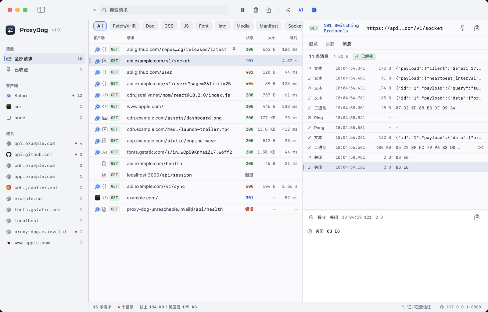

设置页：左侧导航分为连接（HTTP 代理、端口、上游代理/代理链、SOCKS5、SSL 与证书）、规则、外观。

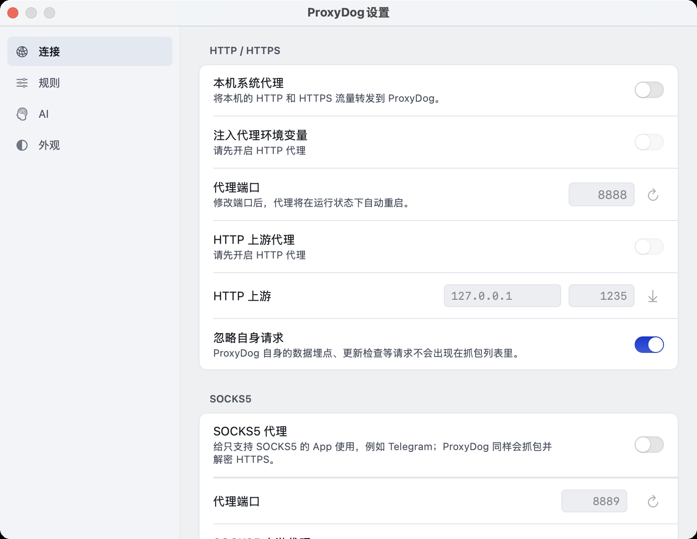

首次启动：一页完成根证书信任、代理地址确认与系统代理设置。

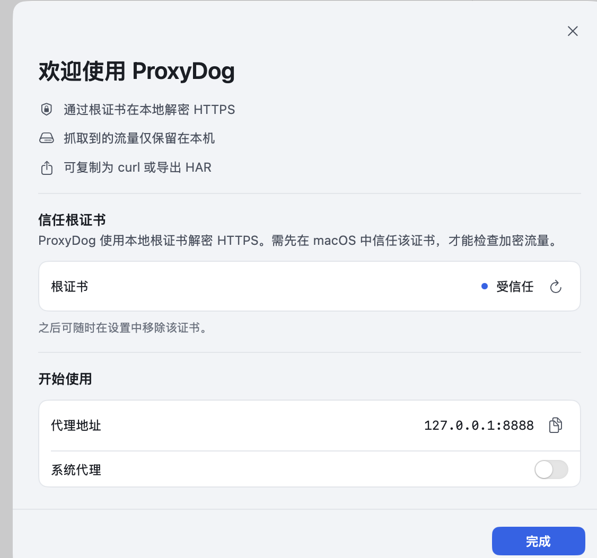

## 语言

界面支持简体中文与 English 两套文案，默认跟随系统语言（本机为中文时即中文界面）。设置 → 外观 → 语言 可在「跟随系统 / 简体中文 / English」之间切换，切换后应用会自动重启。所有界面文案都放在 `Resources/Localization/` 下的 `.strings` 片段里，新增文案时同步补全两种语言，并用 `python3 scripts/check_localization.py` 校验。

## 环境要求

- macOS 14 或更高版本
- Xcode Command Line Tools（`xcode-select --install`），Swift 5.9+；不需要安装完整 Xcode

## 构建与运行

```bash
# 构建可双击运行的 ProxyDog.app（输出到 build/ProxyDog.app）
./scripts/build_app.sh

# 构建并启动
./scripts/run_app.sh
```

首次构建会通过 SwiftPM 拉取 swift-nio / swift-nio-ssl 并编译 BoringSSL，耗时数分钟。

埋点 Key 属于构建期配置：把 `Support/AppConfig.plist.example` 复制为 `Support/AppConfig.plist` 并填入 Aptabase App Key（该文件已加入 `.gitignore`），构建时脚本会把它注入 App 包；不填则埋点自动关闭，界面不会向用户询问 Key。

## 使用

1. 启动后代理自动监听 `127.0.0.1:8888`（可在设置中修改端口）。
2. 首次启动页中安装 ProxyDog 根证书，否则 HTTPS 流量只能看到 CONNECT 隧道。
3. 打开设置页的「HTTP 代理」，或手动把客户端代理指向 `127.0.0.1:8888`。
4. 用 curl 验证：

```bash
curl -x http://127.0.0.1:8888 http://example.com/
curl -x http://127.0.0.1:8888 https://example.com/    # 未安装根证书时 curl 需要加 -k
```

抓到的请求会实时出现在列表中，点击任意一条查看详情。

## 复用已有的代理 / VPN

系统里已经开着一个代理（VPN 客户端、Clash/Surge 之类）时，不需要关掉它：ProxyDog 支持设置**上游代理**，把出站流量再链给它。

1. 打开 设置 → 连接 → 上游代理。**地址会在打开设置页时自动探测并预填**：读取当前系统 HTTP 代理（例如 `127.0.0.1:1235`），无需手工输入；如果系统代理之后变了，点右侧的 ↓ 图标可重新探测。HTTP 与 SOCKS5 两个上游地址各有独立开关（很多 VPN 客户端同时提供两个端口，例如 HTTP `1235` / SOCKS5 `1234`），按入口分别开关即可；地址留空或不完整时该上游会被自动忽略。
2. 然后把系统代理（或你要调试的 App）指向 ProxyDog：`127.0.0.1:8888`。
3. 此后请求先经 ProxyDog 解密抓包，再由 VPN 代理出网；抓包列表里只会出现客户端真实访问的域名，上游代理本身不会出现。

也可以用命令行验证（`--upstream` 支持 `socks5://` 前缀）：

```bash
./.build/debug/ProxyDog --headless --port 8889 --upstream socks5://127.0.0.1:1234 --out /tmp/chained.jsonl
curl -x http://127.0.0.1:8889 https://example.com/
```

限制：上游代理需支持 HTTP CONNECT 或 SOCKS5 匿名连接（不支持需要认证的代理，也不支持 SOCKS5 的 UDP ASSOCIATE）；上游地址不能指向 ProxyDog 自身，否则设置页会报错。

## 局域网设备接入

如果想让同一 Wi-Fi 下的其它设备（手机、平板、另一台电脑）也通过 ProxyDog 抓包：

1. 设置 → 连接 → 局域网访问，打开「允许局域网设备连接」（代理改监听 `0.0.0.0`，关闭后恢复仅本机）。
2. 在设备上把 HTTP 代理设为卡片里显示的「代理地址」，例如 `192.168.31.37:8888`；Android 代理类 App 可直接扫旁边的二维码。
3. 同一张卡片里的「证书地址」`http://<局域网 IP>:8888/ca` 会自动识别设备：iPhone/iPad 下载可安装的描述文件；Android 与鸿蒙 4.x 下载 DER 证书（部分浏览器会直接提示安装，不提示时请到「设置 → 隐私和安全 → 更多安全设置 → 加密和凭据 → 安装数字证书 → CA 证书」选择文件安装）；鸿蒙 NEXT 会显示安装说明页。也可以直接扫「证书二维码」。安装后在系统中信任根证书（iOS 需在「证书信任设置」启用完全信任）。
4. 设备流量会出现在请求列表里，客户端列显示网络图标，侧边栏按「局域网设备 (IP)」分组，点击即可只看该设备。

注意：开启后同网段设备都能使用这个代理，请仅在可信网络使用；HTTPS 解密仍需要设备信任上述根证书，证书固定（pinning）的 App 无法解密。

## 让只支持 SOCKS5 的 App 接入

部分 App（例如 Telegram）只提供 SOCKS5 代理设置。ProxyDog 可以额外开一个 SOCKS5 监听端口：

1. 设置 → 连接 → SOCKS5 代理，打开开关（默认端口 `8889`，可修改）。
2. 在那个 App 里填 SOCKS5 代理：`127.0.0.1:8889`（Hostname 解析交给代理）。
3. 请求出现在 ProxyDog 列表里：HTTPS 自动解密（`已解密`），明文 HTTP 也能抓；连到非 HTTP 协议的 TCP 流量（例如 SSH）只做转发、不显示为请求。

```bash
./.build/debug/ProxyDog --headless --port 8888 --socks-port 8889 --out /tmp/caps.jsonl
curl --socks5-hostname 127.0.0.1:8889 https://example.com/
```

## 请求来自哪个 App

代理只看到 TCP 连接，ProxyDog 会反查是哪个本地进程打开了这条连接：

- 详情页「概览」里显示 **客户端**（App 名，如 Safari）、**进程**（PID，悬停可看可执行路径）和 **User-Agent**。
- 通过 `libproc` 枚举本机进程的 TCP socket 与客户端源端口匹配，不需要额外权限，也不需要安装驱动；从 helper 进程（如 WebKit 网络进程）会向上找到所属的 `.app` 包名。
- 归属是异步解析的：请求先出现，App 信息随后补上；浏览器等长连接会复用连接，开销很小。
- ProxyDog 自身发出的请求（数据埋点、更新检查等）会被自动识别并忽略，不会出现在列表里；该行为默认为开，可在「设置 → 连接 → 忽略自身请求」中关闭。

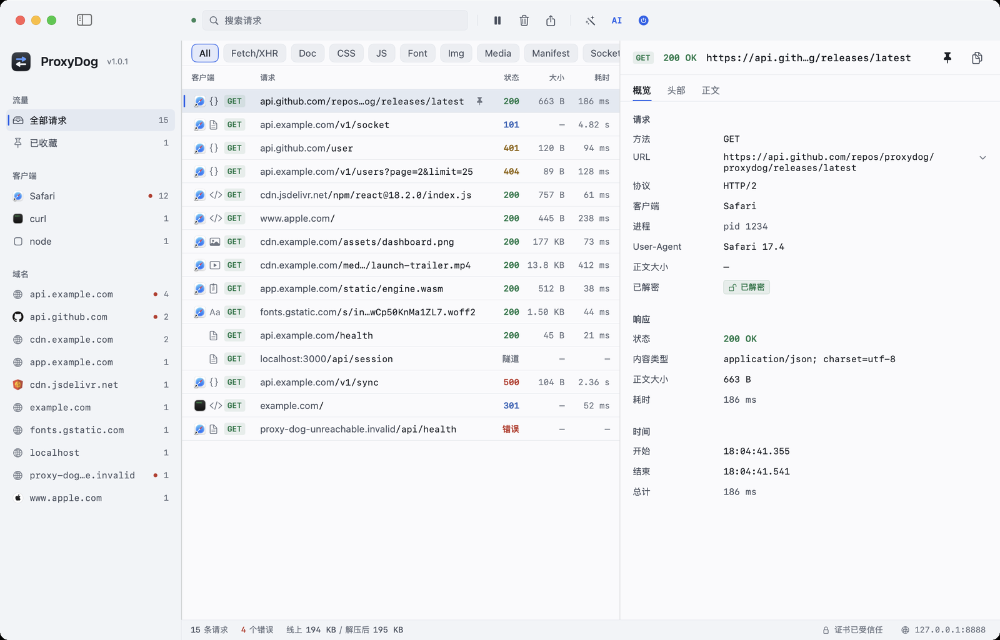

限制：只能看到**当前用户**的进程（root 守护进程可能显示为空）；通过其他机器/设备转到本机代理的流量没有本地进程可言；静态链接或无 socket 归属的极端情况可能无法识别。

## WebSocket 调试

`ws://` 与 `wss://` 都支持：

1. 像普通请求一样出现在列表里（状态 101），`wss://` 会先做 TLS 解密再升级。
2. 选中该请求 → 详情页「消息 / Messages」标签：按时间顺序列出双向消息，箭头表示方向（↑ 客户端→服务端，↓ 服务端→客户端），显示类型、时间、大小和内容预览；点击消息在下方查看完整内容（文本支持 Pretty/Raw 与 JSON 美化，二进制以 Hex 展示）。
3. 消息在连接期间实时追加；超长消息按 512KB 截断（会标注「已截断」，字节数仍为真实大小），每个连接最多保留 2000 条 / 4MB。

```bash
./.build/debug/ProxyDog --headless --port 8888 --out /tmp/caps.jsonl
./scripts/ws_test.py server 18996        # 本地 WS echo 服务器
./scripts/ws_test.py plain 8888 127.0.0.1 18996   # 通过 ProxyDog 跑一次 ws
```

限制：不解析 `permessage-deflate` 压缩帧（按二进制原样保存）、不支持 WebSocket over HTTP/2；ping/pong 与 close 控制帧只记录内容，不影响转发。

## 重写规则（Rewrite）

主窗口工具栏的魔棒图标可直接打开设置规则页；设置 → 重写规则里可以预设静态规则，代理会在转发时自动改写请求/响应，不用写代码；也可以在请求列表右键「重写此地址…」用该请求的 URL 快速创建一条规则。每条规则包含可选的 HTTP 方法、URL 匹配（正则，写普通文本则按子串匹配）和一个动作：

| 动作 | 作用 | 例子 |
|---|---|---|
| 重定向 Redirect | 把请求转发到另一个地址 | 把某个接口 302/302 等价地转到测试环境 |
| 替换请求 Replace request | 用固定内容替换请求正文 | 强制给接口发送固定的测试参数 |
| 替换响应 Replace response | 不请求上游，直接返回本地响应 | 把线上接口返回替换成本地 JSON，模拟后端 |
| 修改请求 Modify request | 对请求正文做正则查找/替换 | 把 `code:0` 批量改成 `code:-1` |
| 修改响应 Modify response | 对响应正文做正则查找/替换 | 测试前端对 `code:-1` 的报错逻辑 |

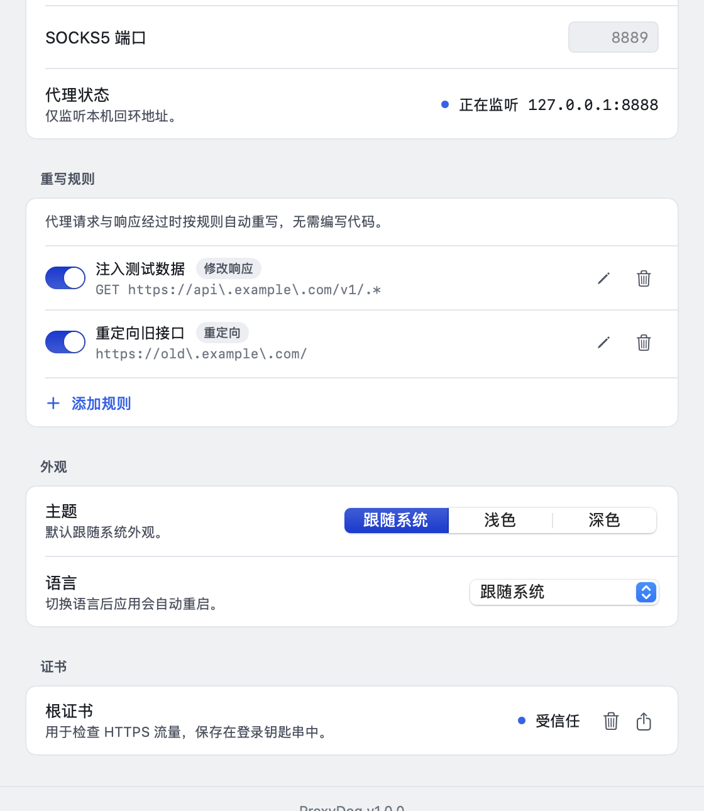

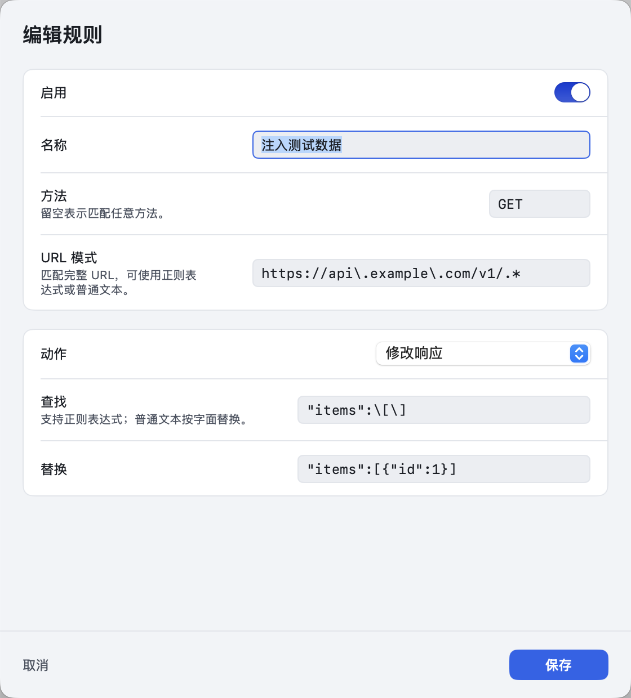

说明：

- 同一阶段只有**第一条匹配且启用**的规则生效；禁用规则不参与匹配
- 修改响应会对 gzip/deflate 响应先解压再改写，然后以未压缩形式返回（Content-Length 会同步修正）；br/zstd、二进制或超过 16MB 的响应会原样透传
- 请求正文替换/修改支持最大 32MB；WebSocket 升级请求不做改写
- 被规则改写的请求会在详情页「概览」里标注「重写 · 动作名」，HAR 导出包含改写后的内容

## 断点（Breakpoint）

和「一直生效」的重写规则不同，断点是**遇到就停、人工修改、单次生效**，适合临时试各种值。设置 → 断点里按 URL（正则/子串 + 可选方法）配置规则，并选择在**请求阶段**或**响应阶段**暂停；也可以在请求列表右键「为此地址打断点…」快速创建（默认在请求阶段暂停）：

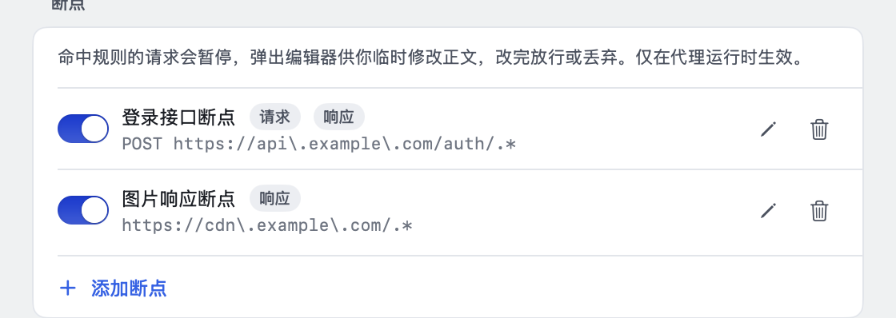

命中后主窗口会弹出不可忽略的编辑器，展示方法与 URL、状态码、原始正文；修改正文后点「放行」继续，或点「丢弃」让该请求失败。多个请求同时命中会排队（显示「还有 N 个等待处理」）：

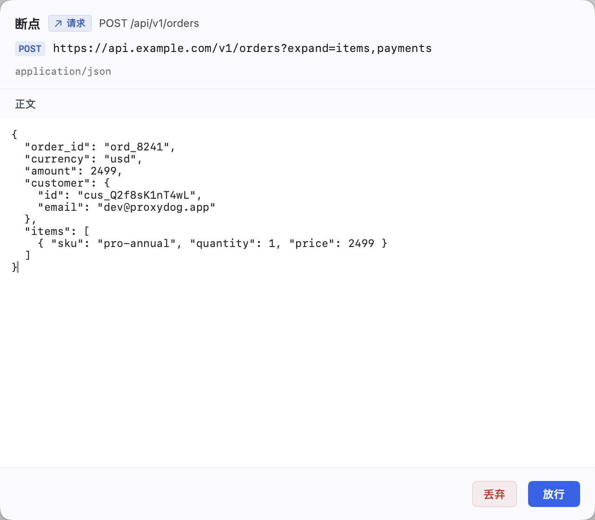

说明：

- 请求阶段：请求在连接上游之前暂停，可改请求正文（Content-Length 自动修正）；丢弃时客户端收到 403，不会请求上游
- 响应阶段：响应在写给客户端之前暂停，可改响应正文（会自动解压 gzip/deflate，改完以未压缩返回并修正 Content-Length）；丢弃时连接被关闭，客户端看到失败
- 只有可解码为 UTF-8 的正文才会暂停（二进制、br/zstd、超大正文自动放行）；WebSocket 升级请求不暂停
- 120 秒内没有选择会自动放行，避免请求永久挂起
- 被断点处理的请求会在详情页「概览」标注「断点 · 阶段」

## 根证书

> HTTPS 解密依赖受信任的根证书：证书未安装/未受信任时「SSL 解密」开关不可开启，代理会自动关闭解密（HTTPS 只显示为隧道）。安装入口在「设置 → 连接」页面底部的「SSL 与证书」区块。

- 位置：`~/Library/Application Support/ProxyDog/Certificates/ca.crt`
- 安装 / 移除：设置页 → 连接 → SSL 与证书；安装会把证书加入登录钥匙串并写入用户信任域，系统会弹出标准授权弹窗。如果安装后仍显示「未受信任」，可在「钥匙串访问」中把 `ProxyDog Root CA` 手动设为「始终信任」，然后回到应用点一次刷新。
- 证书仅用于本机抓包调试，卸载应用后建议在「钥匙串访问」中删除该根证书。

## 自动更新

应用的自动更新是自实现的（与同目录的 TidyMac 项目相同的方案，不依赖 Sparkle）：

1. 启动 3 秒后在后台请求更新清单：`https://api.github.com/repos/welefen/ProxyDog/contents/updates/latest.json?ref=master`，失败时回退到 `https://raw.githubusercontent.com/welefen/ProxyDog/master/updates/latest.json`。
2. 清单包含 `version`、`downloadURL`、`sha256`、`releaseNotes`；若版本高于当前版本则下载 ZIP 并校验 SHA-256。
3. 解压后校验应用包名（`com.proxydog.app`）与版本号，暂存新的 `ProxyDog.app`；点击「安装并重启」后由脚本在应用退出后替换旧包并重新启动。
4. 有可用更新时，主窗口侧边栏版本号位置会出现圆形更新按钮：下载中是向下箭头的脉冲图标，下载完成后变为向上箭头；鼠标悬停展开「完成更新」，点击即安装并重启（与 TidyMac 的交互一致）。
5. 仅在正式安装的 App 中自动检查（`build/` 下的开发构建会跳过）；也可用环境变量调试：`PROXYDOG_UPDATE_FEED`（自定义清单地址）、`PROXYDOG_CURRENT_VERSION`（覆盖当前版本）、`PROXYDOG_UPDATE_TOKEN`（访问私有仓库）、`PROXYDOG_UPDATE_DEBUG=1`（写日志到 `/tmp/proxydog-update-debug.log`）。

发布新版本：

```bash
# 1. 修改 Support/Info.plist 里的 CFBundleShortVersionString
# 2. 生成 dist/ 安装包、updates/ProxyDog-<version>.zip 与 updates/latest.json
./scripts/publish_update.sh
# 3. 提交并推送（或直接 ./scripts/publish_update.sh --push，会同时打 tag）
git add updates scripts && git commit -m "release: ProxyDog <version>" && git push origin master
```

`package.sh` 只打包（`dist/` 下生成 DMG + ZIP 与 SHA256SUMS），`publish_update.sh` 在打包基础上更新 `updates/` 里的清单。仓库需要是公开的，客户端才能直接下载更新包。

> 日常开发提交**不要**运行 `publish_update.sh`，也不要更新 `updates/` 里的 zip/dmg 与清单；只有正式发布版本时才重新生成这些产物并打 tag。

## 数据埋点

埋点使用 Aptabase。App Key 只在**开发构建时**配置一次：`Support/AppConfig.plist` 中的 `AptabaseAppKey` 由 `scripts/build_app.sh` 注入到 App 包的 `Info.plist`，最终用户的设置页和首次启动页里都没有 Key 输入项。该文件不提交到仓库，留空则埋点完全关闭。

事件只包含启动、开始/停止代理、导出等行为与操作系统版本等基础信息，不含任何请求内容，因此不提供隐私协议页面。调试时也可以用环境变量 `PROXYDOG_APTABASE_KEY` 或启动参数 `--aptabase-key` 临时覆盖。

## 项目结构

```
Sources/ProxyDog/
├── ProxyDogApp.swift        # SwiftUI 入口、窗口、菜单
├── AppState.swift           # 应用状态与动作（UI 唯一数据入口）
├── main.swift               # 正常启动 / --headless 分流
├── Models/                  # 抓包数据模型、存储、设置、构建期配置、HAR、埋点
├── Core/                    # NIO 代理引擎、证书颁发、系统代理
├── UI/                      # 主窗口、设置页、首次启动页、设计系统
└── Dev/                     # headless 运行与自检
scripts/                     # 构建、运行、测试、截图、图标、演示流量
Support/                     # Info.plist、应用图标、AppConfig.plist(.example)
```

## 开发与测试

```bash
# 快速编译检查
./scripts/build.sh

# 端到端代理测试：明文 HTTP、HTTPS 解密、POST、失败请求、抓包断言、端口复用
./scripts/test_proxy.sh

# 上游代理（代理链）测试：内置本地双协议代理（HTTP CONNECT + SOCKS5）
./scripts/test_upstream.sh
UPSTREAM_REAL=127.0.0.1:1235 ./scripts/test_upstream.sh   # 再用真实 VPN 的 HTTP 代理跑一遍

# HTTP/2 测试：ALPN 协商 h2、h2 抓包断言、HTTP/1.1 回退
./scripts/test_http2.sh

# 重写规则测试：5 种动作 + 禁用规则 + 抓包标注
./scripts/test_rewrite.sh

# 断点测试：请求/响应暂停改正文、丢弃、禁用规则、抓包阶段
./scripts/test_breakpoint.sh

# 请求归属测试：curl / Python 客户端 / MITM / SOCKS5 连接都能识别出 App
./scripts/test_attribution.sh

# WebSocket 测试：ws/wss 握手、MITM 解密、双向消息解析、分片重组、1MB 截断
./scripts/test_websocket.sh

# SOCKS5 监听器测试：HTTPS 解密、HTTP 捕获、SOCKS5 上游链路、失败路径
./scripts/test_socks.sh
UPSTREAM_SOCKS_REAL=socks5://127.0.0.1:1234 ./scripts/test_socks.sh   # 再用真实 VPN 的 SOCKS5 端口跑一遍

# 无界面自检：证书签发、HAR 导出、cURL 导出、进程内重启、端口占用、设置持久化
./.build/debug/ProxyDog --headless --selftest

# 无界面启动代理（输出 JSON Lines 抓包事件）
./.build/debug/ProxyDog --headless --port 8899 --out /tmp/captures.jsonl

# 校验中英文案完整性
python3 scripts/check_localization.py

# 打包 / 发布更新（生成 dist 与 updates/latest.json）
./scripts/package.sh
./scripts/publish_update.sh

# 生成演示流量 / 重置应用状态 / 截取窗口
./scripts/demo_traffic.sh
./scripts/reset_app.sh
./scripts/screenshot.sh /tmp/proxydog.png
```

开发调试时可以载入一组示例流量，便于在没有真实请求时检查界面（`--sample-tab body` 会打开 Body 页，`--sample-request N` 选中第 N 条）。压力测试可以用 `--sample-stress N` 一次载入 N 条模拟请求（会临时放宽 2000 条的内存上限，并在 stderr 打印加载/过滤/布局耗时与内存占用）：

```bash
defaults write com.proxydog.app app.onboardingCompleted -bool true
./build/ProxyDog.app/Contents/MacOS/ProxyDog --sample-traffic
./build/ProxyDog.app/Contents/MacOS/ProxyDog --sample-traffic --sample-tab body
./build/ProxyDog.app/Contents/MacOS/ProxyDog --sample-traffic --sample-stress 10000   # 大量数据压力测试
```

## 已知限制

- HTTP/2 只做到「客户端侧 h2」：与浏览器之间协商 HTTP/2 并按流抓包，但转发到源站时固定用 HTTP/1.1（不做 h2→h2 端到端），也不支持 HTTP/2 的 Server Push、h2 扩展 CONNECT / WebSocket、trailer 与 1xx 响应展示；SOCKS5 监听端口的 MITM 仍为 HTTP/1.1。
- HTTP/3（QUIC）暂不支持：QUIC 走 UDP，macOS 的 HTTP/HTTPS 系统代理只转发 TCP，所以浏览器使用代理时会回退到 h2/h1，抓包内容依然完整；但真正基于 QUIC 的流量不会经过 ProxyDog。要拦截 QUIC 需要系统级 UDP 拦截（Network Extension / System Extension + 签名授权）和完整的 QUIC + HTTP/3 协议栈，不属于当前这个纯 App 形态能提供的功能。响应头带 `Alt-Svc: h3` 时，详情页会在「响应」区标注该站点支持 HTTP/3（仅作提示，QUIC 流量本身仍无法抓取）。
- 上游 TLS 不校验证书，便于抓取自签名证书的开发服务器。
- WebSocket 不解析 `permessage-deflate` 压缩帧，也不支持 WebSocket over HTTP/2（h2 扩展 CONNECT 会以失败记录并在详情中说明）。
- 单个请求/响应体最多保存 2 MB（超出部分仍然透传，仅不入库）。
- 关闭系统代理时直接关闭代理开关，不会恢复开启前的原有代理配置。

## 版本

v1.0.0
